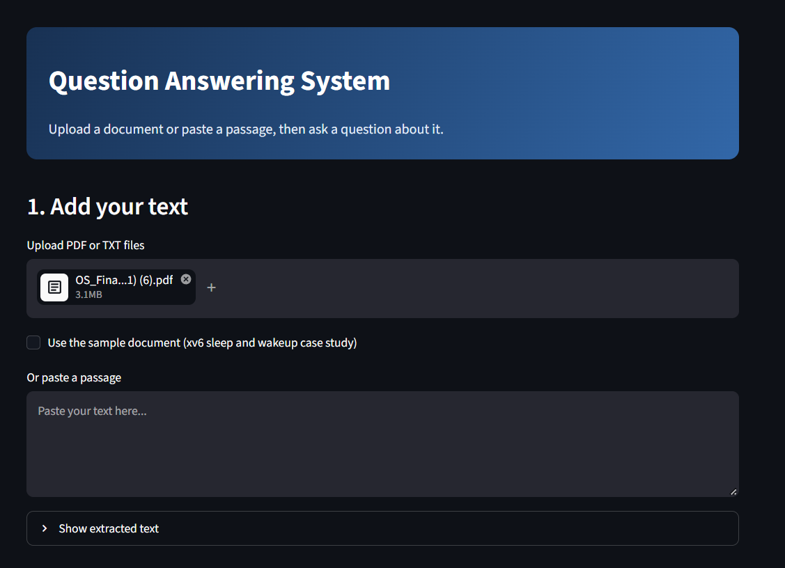
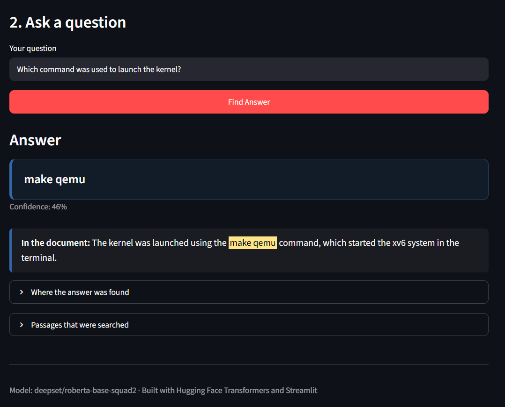
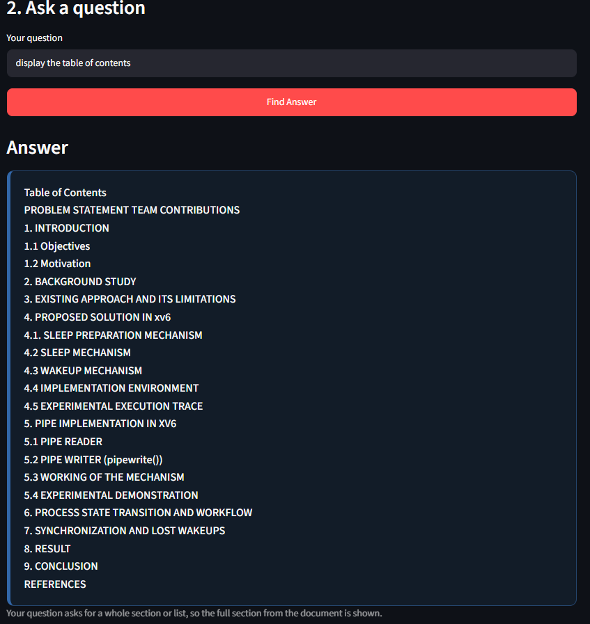
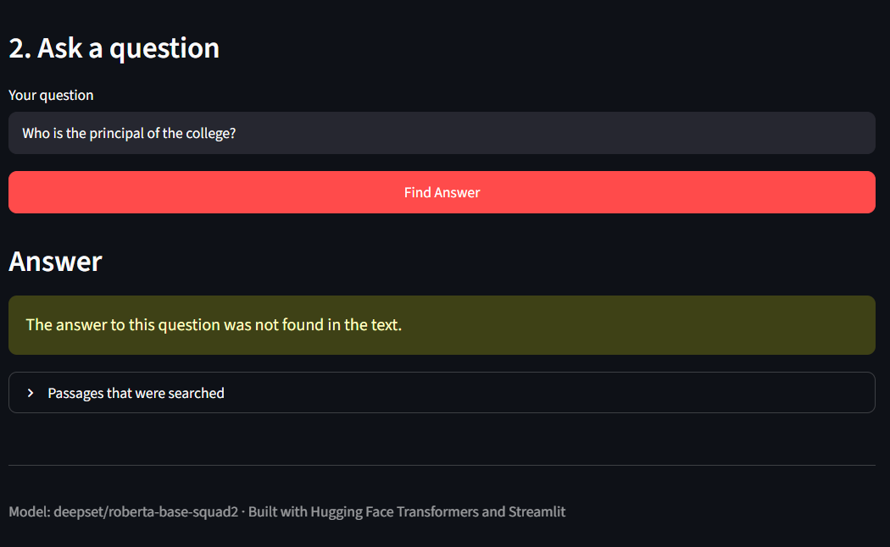

# Question Answering System

**Live demo:** https://pujitha-ques-system.streamlit.app/

A machine learning system that answers questions from passages and documents (PDF / TXT).
Upload a document, ask a question in plain English, and the system returns the answer from the text,
shows where it came from, and says so when the answer is not in the document instead of guessing.

Developed as part of the **Wheeltrix internship** (User Question Answering project).

**Team Leader:** P. Satya Pujitha

Built with Python, Hugging Face Transformers (RoBERTa / DistilBERT), Sentence-Transformers, scikit-learn and Streamlit.

---

## Screenshots

| Home | Short answer |
|---|---|
|  |  |

| Whole-section answer | Answer not in the document |
|---|---|
|  |  |

---

## Features

**Documents**
- Upload one or more PDF or TXT files, or paste a passage
- OCR for PDF pages that are images (scanned notes, slide screenshots)

**Finding the answer**
- Hybrid retrieval: semantic search (MiniLM sentence embeddings) + keyword search (TF-IDF)
- Re-ranking of the best passages with a cross-encoder
- Transformer reader (RoBERTa fine-tuned on SQuAD 2.0) extracts the exact answer

**Answer types**
- Short answers for facts ("Which command was used to launch the kernel?" → *make qemu*), with the full sentence shown and the answer highlighted
- Sentence answers for explanations ("What did X do?", "Explain ...", "Why ...") and for typos
- Section answers for lists ("Display the table of contents", "What are the limitations?")
- "Not found" when the document does not contain the answer

**Machine learning**
- Dataset: SQuAD 2.0 + a hand-written test set
- Fine-tuning script and free Google Colab notebook
- Evaluation with Exact Match (accuracy) and F1-score on three test sets

---

## How it works

```
 PDF / TXT / passage
        │
        ▼
 1. Text extraction & cleaning      preprocessing/text_cleaning.py
    (layout-aware PDF reading, rebuild sentences, remove table-of-contents dots)
        │
        ▼
 2. Chunking                        preprocessing/chunking.py
    (≈250-token chunks split on paragraph boundaries)
        │
        ▼
 3. Retrieval                       preprocessing/retrieval.py
    a) score = 0.6 × semantic similarity (all-MiniLM-L6-v2)
             + 0.4 × keyword similarity (TF-IDF)    → top-15 candidates
    b) cross-encoder re-ranking (ms-marco-MiniLM-L-6-v2) → top-5 chunks
        │
        ▼
 4. Reader                          qa_engine.py
    transformer QA model predicts the START and END token of the answer
    in each chunk (or "no answer"); the highest-scoring answer wins
        │
        ▼
 5. Answer type                     qa_engine.py, preprocessing/sections.py
    list / section request   → whole section   ("What are the limitations?")
    explanation question     → best sentence   ("What did X do?")
    fact question            → short answer    ("Which command ...?")
    nothing relevant enough  → "not found"
        │
        ▼
 Answer + supporting passage + confidence
```

---

## Dataset

| Dataset | Size | Used for |
|---|---|---|
| [SQuAD v2.0](https://huggingface.co/datasets/rajpurkar/squad_v2) (Stanford) | 130k train / 12k validation questions on Wikipedia passages; ⅓ are unanswerable | Fine-tuning and evaluation |
| **Custom dataset** – [data/custom_qa.json](data/custom_qa.json) | 60 hand-written questions on 14 passages (education, customer support, operating systems); 12 unanswerable | Evaluation on new domains |
| **Document dataset** – [data/document_qa.json](data/document_qa.json) | 20 questions on a full case-study document ([data/documents/](data/documents/)); 3 unanswerable | Evaluation of the complete pipeline (retrieval + reader), exactly as the app runs |

Every answer in the custom datasets is copied exactly from its passage (checked automatically by the tests).

---

## Evaluation metrics

Following the official SQuAD evaluation:

- **Exact Match (EM)** – % of questions where the predicted answer is exactly correct (after lower-casing and removing punctuation/articles). This is the **accuracy**.
- **F1-score** – word overlap between prediction and correct answer:
  `precision = common words / predicted words`, `recall = common words / true answer words`, `F1 = 2PR / (P + R)`.
- For an unanswerable question the model scores 1 only if it answers "no answer".

Implementation: [evaluation/metrics.py](evaluation/metrics.py)

---

## Results

| Model | SQuAD v2 EM | SQuAD v2 F1 | Custom EM | Custom F1 | Document EM | Document F1 | No-answer F1 (SQuAD) | Sec / question |
|---|---|---|---|---|---|---|---|---|
| `deepset/roberta-base-squad2` (pre-trained on SQuAD 2.0) | **80.0** | **83.2** | **95.0** | **97.7** | **85.0** | **90.3** | **81.5** | 0.94 |
| `distilbert-base-cased-distilled-squad` (SQuAD 1.1 only – baseline) | 37.2 | 40.7 | 70.0 | 73.6 | 45.0 | 49.7 | 0.0 | 0.35 |
| **Our fine-tuned DistilBERT** (`distilbert-base-uncased` → SQuAD 2.0, trained by us) | 66.0 | 69.1 | 75.0 | 77.2 | 65.0 | 71.7 | 67.2 | 0.27 |

SQuAD v2 = 500 random validation questions. All speeds measured on the same laptop CPU. Full per-question outputs are in [results/](results/).

**Fine-tuning details:** `distilbert-base-uncased` trained on all 130,319 SQuAD 2.0 training questions for 2 epochs
(learning rate 3e-5, batch size 16, max length 384, stride 128) on a free Google Colab T4 GPU in **40.5 minutes**.
Training loss fell from 5.8 to about 0.9. Validation loss was 1.19 after epoch 1 and 1.25 after epoch 2, a small sign of
overfitting in the second epoch.

**Observations**

- The SQuAD 1.1 baseline never saw unanswerable questions during training, so it *always* returns some text – its no-answer F1 is 0 and it fails badly on SQuAD v2. Training on SQuAD 2.0 is essential for a real-world system.
- Fine-tuning worked: our DistilBERT reached 69.1 F1 on SQuAD 2.0, 28 points above the SQuAD 1.1 baseline, and learned to detect unanswerable questions (67.2 no-answer F1 vs 0).
- RoBERTa-base is still more accurate (83.2 F1): it has about twice as many parameters (125M vs 66M) and was pre-trained on 10x more text. The app therefore uses RoBERTa (`DEFAULT_MODEL` in `qa_engine.py`); all models can be compared with `scripts/evaluate_qa.py --model ...`.
- Speed vs accuracy: our DistilBERT answers 3.5x faster (0.27 s vs 0.94 s per question on CPU), which matters on free, CPU-only hosting.
- Document-level F1 (90.3) is a bit lower than passage-level (97.7) because the system must first *find* the right part of the document. Exact Match is lower (85%) partly because descriptive questions are now answered with a full sentence (e.g. "The scheduler selects the runnable process for execution."), which is correct but not an exact match of the short reference answer.
- Small fixes in preprocessing made a big difference: reading PDFs in layout mode (the default mode put every word on its own line) and cutting answers at paragraph breaks raised document accuracy from 80% to 90%.

---

## Project structure

```
Question-Answering-System/
├── app.py                        # Streamlit web app
├── qa_engine.py                  # core QA pipeline (used by app + evaluation)
├── preprocessing/
│   ├── text_cleaning.py          # PDF extraction and text cleaning
│   ├── chunking.py               # split documents into chunks
│   ├── sections.py               # split documents into headed sections
│   └── retrieval.py              # hybrid semantic + keyword retrieval
├── evaluation/
│   ├── metrics.py                # Exact Match and F1
│   └── qa_datasets.py            # load SQuAD v2 / custom / document datasets
├── scripts/
│   ├── train_qa.py               # fine-tune a BERT-style model on SQuAD v2
│   ├── evaluate_qa.py            # evaluate any model on any dataset
│   └── make_results_table.py     # build results/RESULTS.md
├── notebooks/
│   └── Train_QA_Colab.ipynb      # free-GPU training + evaluation notebook
├── data/                         # custom datasets + sample document
├── docs/screenshots/             # app screenshots used in this README
├── results/                      # evaluation outputs (JSON + RESULTS.md)
├── tests/test_core.py            # unit tests
├── requirements.txt
└── requirements-dev.txt
```

---


## Run it on your computer

Requires Python 3.10+.

```bash
git clone https://github.com/pujithavarma17/Question-Answering-System.git
cd Question-Answering-System

python -m venv .venv
# Windows:            .venv\Scripts\activate
# macOS / Linux:      source .venv/bin/activate

pip install -r requirements.txt
streamlit run app.py
```

The first run downloads the models (~600 MB). Then open http://localhost:8501, tick **"Use the sample document"** and ask e.g. *"Which command was used to launch the kernel?"*

## Evaluate

```bash
python scripts/evaluate_qa.py --data custom                 # 60 custom questions
python scripts/evaluate_qa.py --data document               # full-document questions
python scripts/evaluate_qa.py --data squad --n 500          # SQuAD v2 sample
python scripts/evaluate_qa.py --data custom --model models/qa-distilbert-squad2   # after fine-tuning (see below)
python scripts/make_results_table.py                        # comparison table
```

## Fine-tune (free GPU)

Open [notebooks/Train_QA_Colab.ipynb](notebooks/Train_QA_Colab.ipynb) in [Google Colab](https://colab.research.google.com),
select **Runtime → Change runtime type → T4 GPU**, and run all cells (~1 hour).
It fine-tunes `distilbert-base-uncased` on SQuAD 2.0 and evaluates it. The trained model (265 MB) is not stored in this repository; the notebook can download it or upload it to the Hugging Face Hub.

On your own machine (slow without a GPU – use only for testing):

```bash
python scripts/train_qa.py --train_samples 500 --eval_samples 100 --epochs 1
```

## Tests

```bash
pip install -r requirements-dev.txt
python -m pytest
```

---

## Limitations

- Answers are always taken from the document (a phrase, a sentence or a section). The system does not generate new text, so it cannot summarise or answer yes/no questions.
- **Scanned pages / slide screenshots** are read with OCR (RapidOCR). This is slower (~4 s per page) and OCR can misread some characters.
- **List-type questions** work when the list is a section with a heading; lists that are spread across a page without a heading may still be missed.
- **Complex layouts** (tables, multi-column pages) may be extracted in the wrong order.
- **English only.**
- One answer per question; information spread across several places is not combined.
- Section answers depend on the document having clear headings.

## Future work

- Faster OCR (GPU) and better handling of tables
- Generative answers with a sequence-to-sequence model
- Fine-tuning on domain-specific question–answer pairs
- Multilingual models

---

## References

- Rajpurkar et al., *Know What You Don't Know: Unanswerable Questions for SQuAD* (SQuAD 2.0), ACL 2018
- Devlin et al., *BERT: Pre-training of Deep Bidirectional Transformers for Language Understanding*, NAACL 2019
- Liu et al., *RoBERTa: A Robustly Optimized BERT Pretraining Approach*, 2019
- Sanh et al., *DistilBERT, a distilled version of BERT*, 2019
- Reimers & Gurevych, *Sentence-BERT*, EMNLP 2019
- [Hugging Face Transformers](https://huggingface.co/docs/transformers) · [Streamlit](https://streamlit.io)

## License

[MIT](LICENSE)
